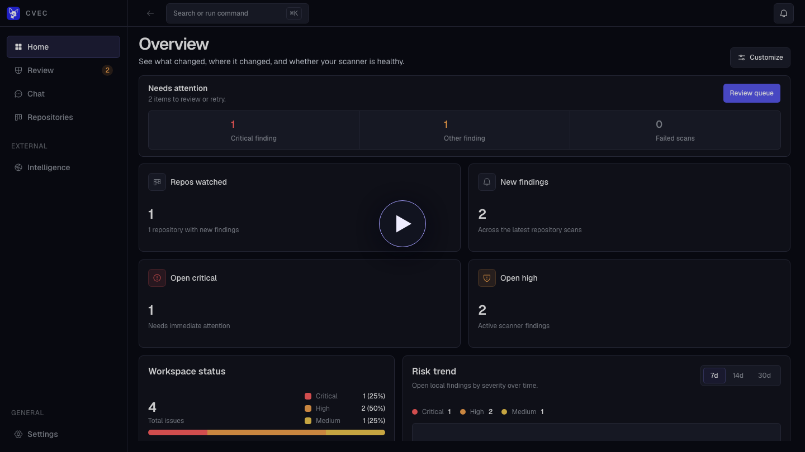

# CVEC

CVEC is a local-first macOS desktop app for scanning and reviewing dependency vulnerabilities across local and linked GitHub repositories.

- **Local & GitHub scanning:** Uses Syft and Grype with a cached local SBOM inventory and stores all history in SQLite.
- **Focused review queue:** Tracks new, escalated, and resolved findings, with macOS notifications only for new `HIGH` or `CRITICAL` issues.
- **Public advisory feed:** Fetches OSV, GitHub, NVD, and CISA KEV advisories and matches them against packages in your scanned repos.
- **Optional AI chat & isolated fixes:** Read-only repository chat and explicit, worktree-isolated fix workspaces via Codex, Grok, or OpenCode.
- **No backend or account:** Everything stays on your Mac; network calls go directly to external services only when used.

**v0.1.0 (macOS beta)** · [cvec.app](https://cvec.app) — Build and run CVEC locally on macOS.

[](docs/media/cvec-walkthrough.gif)

<sub>[Watch the 23-second walkthrough](docs/media/cvec-walkthrough.gif) · [Download MP4](docs/media/cvec-walkthrough.mp4?raw=true) · Sample repository and simulated chat response.</sub>

## Build and run on macOS

### Prerequisites

- macOS 12+ with Xcode Command Line Tools (`xcode-select --install`)
- [Homebrew](https://docs.brew.sh/Installation)
- Node (`22.23.5+`, `24.22.3+`, or `26.13.1+`), Rust, `syft`, and `grype`:

```sh
brew install node@22 rust syft grype
export PATH="$(brew --prefix node@22)/bin:$PATH"
```

### Quickstart

From the repository root:

```sh
npm ci
npm run signing:setup
npm run signing:doctor
npm run tauri -- dev
```

`signing:setup` creates a one-time **local self-signed development certificate** in your macOS Keychain (no paid Apple Developer account needed). If macOS prompts for `codesign`, approve it in the system dialog and retry `npm run tauri -- dev` if the first launch times out. See [Local development and Keychain](docs/local-development-keychain.md).

The first Rust build takes a few minutes. Once CVEC opens, go to **Repositories → Choose folder**, pick a Git repo or parent directory, and click **Scan all**. See [Getting started](docs/getting-started.md) for more details and known limitations.

## Data and network access

CVEC needs no account or backend. Repository metadata, scans, settings, and cached conversations stay in local SQLite. Advisory lookups, vulnerability database downloads, and optional GitHub features connect directly to their respective services.

AI connections are optional. After explicit consent, your prompt and disclosed repository context are sent to the selected connection (a local CLI can still call a cloud model). Fix workspaces can send additional worktree source/check output and edit their isolated Git worktree—always review diffs before applying changes. See [AI connections](docs/ai-connections.md), [Fix workspaces](docs/fix-workspaces.md), and [Security](SECURITY.md).

## Development

Run `npm run check` and `cargo test --manifest-path src-tauri/Cargo.toml --locked` before opening a pull request. See [Contributing](CONTRIBUTING.md#checks) for the full check suite (`clippy`, `npm audit`, `cargo-audit`) and [dependency assurance](docs/dependency-assurance.md) for the reviewed transitive Cargo exceptions.

## Documentation

- [Getting started and limitations](docs/getting-started.md)
- [AI connections and repository chat](docs/ai-connections.md)
- [Optional GitHub access](docs/github-connection.md)
- [Provider fix workspaces](docs/fix-workspaces.md)
- [Architecture](docs/architecture.md)
- [Local data and SQLite](docs/local-data.md)
- [Contributing](CONTRIBUTING.md)
- [Security policy](SECURITY.md)
- [Third-party licenses and assets](THIRD_PARTY_NOTICES.md)

CVEC's own source is licensed under [MIT](LICENSE). Third-party dependencies retain their own licenses.
