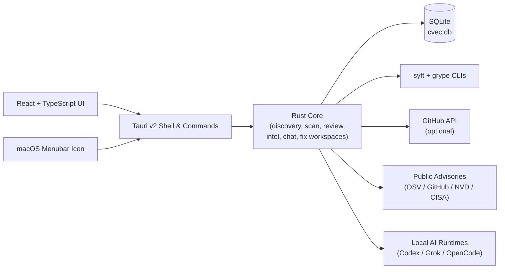

# CVEC Architecture

CVEC is a local-first, macOS-first Tauri v2 desktop app for scanning dependency vulnerabilities in local and linked GitHub repositories, reviewing findings, browsing public security advisories, and running optional AI chat or isolated fix workspaces.

There is no CVEC backend, account system, or cloud sync. All metadata, scan history, review decisions, and cached chat timelines remain in local SQLite.

## System overview

## Module layout

- **`src/`** — React + TypeScript frontend (Overview dashboard, Review board/table and finding inspector, Repository workspace, Intelligence feed, Chat & Fix workspaces, Command Palette, Settings). Business logic stays in Rust; the UI stays thin.
- **`src-tauri/src/lib.rs`, `desktop_window.rs`, `runtime.rs`** — Tauri bootstrap, menubar tray icon, window state restoration, and bounded background/IO task execution.
- **`src-tauri/src/*commands.rs`** — Tauri IPC boundaries for workspace/scanning (`commands.rs`), chat (`companion_commands.rs`), AI connections (`provider_connection_commands.rs`), and fix workspaces (`fix_workspace_commands.rs`).
- **`src-tauri/src/core/repo_discovery.rs` & `github*.rs`** — Local Git repository discovery, optional GitHub App device-flow sign-in (tokens in macOS Keychain), and remote repository materialization for scanning.
- **`src-tauri/src/core/scanner.rs`, `inventory_cache.rs`, `delta.rs`** — `syft` / `grype` subprocess orchestration, SHA-256-fingerprinted Syft SBOM cache, remediation evidence extraction, and new/resolved/escalated finding deltas.
- **`src-tauri/src/core/external_intel.rs`, `external_topics.rs`, `assets.rs`** — Public advisory fetching, normalization, and matching against local repository packages.
- **`src-tauri/src/core/companion*.rs`, `grok_host.rs`, `opencode_*.rs`, `provider_*.rs`** — Read-only Repository Chat orchestration, bounded context redaction/packaging, and supervised AI CLI hosts.
- **`src-tauri/src/core/fix_workspaces/` & `fix_runtime/`** — Isolated Git worktree management, macOS-sandboxed check execution, private loopback MCP bridge, and worktree rescans.
- **`src-tauri/src/core/db.rs` & `core/db/`** — SQLite schema, migrations, review projections, chat timeline cache, and fix workspace persistence.
- **`src-tauri/src/state.rs` & `core/scheduler.rs`** — Shared state, exclusive scan/DB-update coordination, and optional 12-hour scan schedule.

## Core workflows

1. **Startup:** `bootstrap()` immediately returns the last persisted snapshot from SQLite so the window opens without blocking on filesystem traversal or CLI checks. Discovery and scanner status refresh in the background via `cvec://state` events.
2. **Scanning:** Scans run sequentially per repository with an exclusive scan lock. Local repositories reuse cached Syft SBOMs when their source fingerprint matches, then run `grype` against the current local vulnerability DB. Repo-level scan errors fail only that repository and never abort the rest of a scan-all run.
3. **Review & notifications:** Findings are fingerprinted across scans to track new, escalated, and resolved items while preserving user review/snooze decisions. Native macOS notifications trigger only for new `HIGH` or `CRITICAL` findings.
4. **AI Chat & Fix:** Rust enforces the security boundary. Analysis prepares a bounded, redacted context pack (excluding sensitive paths, secrets, and binaries) and denies provider tools. Fix mode uses an explicit disclosure, an isolated Git worktree, restricted CVEC-owned tools, and sandboxed checks.

## Local storage and macOS integrations

- **Database & worktrees:** `~/Library/Application Support/dev.cvec.app` (`cvec.db`, `fix-workspaces/`). See [local data](local-data.md).
- **Scanner cache:** Tauri app cache directory (`grype/db` and `inventory/`).
- **Scanner lookup:** Checks `/opt/homebrew/bin`, `/usr/local/bin`, and sanitized absolute `PATH` entries so Finder/GUI launches find `syft` and `grype` without a login shell.
- **Native features:** Menubar tray icon with status dot, Dock badge for open review items, native folder picker, notifications, and macOS Keychain for CVEC-managed credentials.
